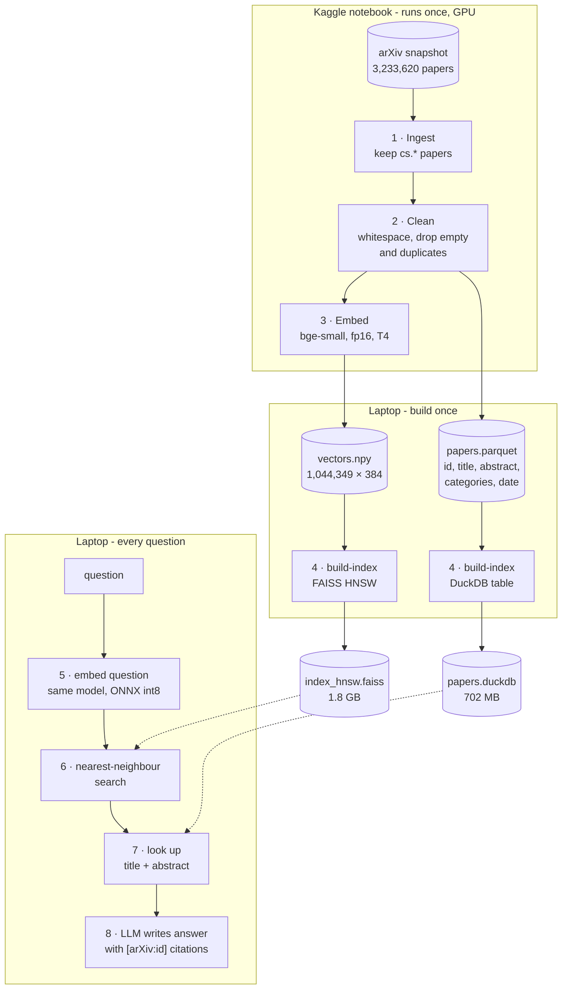

# PaperTrail architecture

PaperTrail answers questions about computer science research. It finds the arXiv papers closest in meaning to a question, then an LLM writes an answer from those papers' abstracts and cites each one.

- **Corpus:** 1,044,349 arXiv computer science papers (title + abstract)
- **Split:** the heavy one-time work (embedding) ran on a free Kaggle GPU; everything else runs on a laptop CPU

## System design

**How to read it:** vectors are only used to *find* papers. The LLM never sees vectors; it receives the original title and abstract text. Row *i* of `vectors.npy` is paper *i* of `papers.parquet`, and that row number is the link between FAISS (numbers) and DuckDB (text).

## What each step does

| Step | Where | What happens | Output |
| --- | --- | --- | --- |
| 1 · Ingest | Kaggle | Stream the 4–5 GB JSON snapshot line by line; keep papers with any `cs.*` category; write in batches of 100k | 11 Parquet files, 1,045,061 papers |
| 2 · Clean | Kaggle | Collapse whitespace, drop empty, short and withdrawn abstracts, drop exact duplicates, count tokens | `clean.parquet`, 1,044,349 papers |
| 3 · Embed | Kaggle | Turn each `title + abstract` into 384 numbers, in shards of 100k (finished shards are skipped on rerun) | `vectors.npy`, `papers.parquet` |
| 4 · Build index | Laptop | Link every vector to its nearest neighbours (HNSW); load paper text into DuckDB | `index_hnsw.faiss`, `papers.duckdb` |
| 5 · Embed question | Laptop | Same model, run with ONNX Runtime as int8, with bge's query prefix | 384 numbers |
| 6 · Search | Laptop | Walk the HNSW graph to the 8 closest papers | row numbers + similarity scores |
| 7 · Look up | Laptop | Fetch those rows' text from DuckDB; optional category filter | 8 papers |
| 8 · Answer | Internet | Send instructions + 8 abstracts + question to the LLM | cited answer |

**Why no chunking step:** the model reads at most 512 tokens. The median paper is 252 tokens and only 3,769 papers (0.36%) are longer, so each paper is one vector. Those few are cut at 512 tokens, losing the end of their abstract.

## Measured numbers

### Data

| Measure | Value |
| --- | --- |
| Papers in the arXiv snapshot | 3,233,620 |
| Computer science papers kept | 1,045,061 |
| After cleaning | 1,044,349 (712 removed) |
| Tokens per paper | median 252, mean 254, max 1,170 |
| Papers over the 512-token limit | 3,769 (0.36%) |

### Embedding on Kaggle

| Measure | Value |
| --- | --- |
| GPU | NVIDIA Tesla T4 (one of the two in "GPU T4 x2") |
| Model | `BAAI/bge-small-en-v1.5`, half precision (fp16), batch size 256 |
| Papers embedded | 1,044,349 |
| Output | 1,044,349 × 384 float16 = 765 MB |
| Speed (papers/s) and total time | **Not recorded yet** - from the `part N: ... papers/s` lines of the Kaggle run |

### Laptop (ASUS Vivobook 16, Intel i7-13620H, 16 GB RAM, 7.6 GB available to WSL)

| Measure | Value |
| --- | --- |
| Index build | 7.3 min (~2,400 vectors/s, 8 threads) |
| Index file | 1.8 GB |
| DuckDB file | 702 MB |
| Measure | v0-baseline (PyTorch encoder) | v1-onnx-int8 (current) |
| --- | --- | --- |
| Startup: import libraries | 12.3 s | 0.2 s |
| Startup: load embedding model | 0.8 s | 0.5 s |
| Startup: load index from disk | 4–17 s (varies with disk cache) | same |
| Per question: embed question | 190 ms | 13 ms |
| Per question: FAISS search | 3 ms | 4 ms |
| Per question: DuckDB lookup | 22 ms | 19 ms |
| Per question: search total | 225 ms | 38 ms |
| Per question: LLM answer (free Nemotron 3 Ultra) | ~20–25 s | ~18 s |

Search timings are medians of 30 runs from `papertrail bench`. Every run is logged in `logs/timings.log`; changes are listed in `logs/CHANGES.md`.

**Where the time goes:** the LLM call now accounts for almost all of a question's time. Startup is dominated by loading the 1.8 GB index.

## Components: why we use them, and how they scale

### Kaggle notebook with a T4 GPU
**Why:** embedding a million papers is heavy matrix maths that a GPU does far faster than a laptop CPU. Kaggle gives a free GPU and already hosts the arXiv dataset, so nothing had to be downloaded first.
**At scale:** this is a batch job that runs once. New papers only need their own vectors, not a full rerun. For larger corpora the same script runs on any cloud GPU, and the 100k-paper shards can be split across several GPUs.

### Parquet files
**Why:** typed, compressed, column-based storage. Later steps read only the columns they need instead of re-parsing JSON text every time.
**At scale:** sharded Parquet is the standard input for parallel processing (several workers, one shard each), and DuckDB, Spark and pandas all read it directly.

### Embedding model: `BAAI/bge-small-en-v1.5`
**Why:** strong retrieval quality for its size (~33M parameters). Its 384 numbers per paper keep storage and search cheap.
**At scale:** storage and memory grow with the number of papers × dimensions, so small vectors keep 10M papers practical. Changing the model later means re-embedding every paper, and questions must always use the same model as the papers.

### Question encoder: ONNX Runtime, int8
**Why:** papers were embedded once on the GPU, but every question is embedded on the laptop CPU. PyTorch took 12 s just to import and 190 ms per question. The same model exported to ONNX with int8 weights (`scripts/export_encoder.py`) runs with only `onnxruntime` and `tokenizers`: 0.2 s to import and 13 ms per question.
**Accuracy:** checked against PyTorch on 1,010 questions (`scripts/compare_encoders.py`). With 1,000 paper titles as questions, the right paper ranks first 92.1% of the time (PyTorch 92.0%) and is in the top 10 97.1% of the time (PyTorch 97.0%). About 10% of lower-ranked results change places. `tests/test_encoder.py` guards this.

| Backend (`EMBED_BACKEND`) | Similarity to PyTorch | Right paper 1st / top 10 | Embed | Cold start |
| --- | --- | --- | --- | --- |
| `torch` (original) | 1.000 | 92.0% / 97.0% | 28 ms | 12.7 s |
| `onnx` (float32) | 1.000 | 92.0% / 97.0% | 13 ms | 2.0 s |
| **`onnx-int8`** (default) | 0.997 | 92.1% / 97.1% | 10 ms | 0.8 s |
| `onnx-int8-avx2` | 0.997 | 92.8% / 97.3% | 13 ms | 1.0 s |
| `openvino` (float32) | 1.000 | 92.0% / 97.0% | 15 ms | 1.5 s |
| `openvino-int8` | 0.994 | 91.4% / 96.4% | 11 ms | 3.3 s |

Embed and cold start measured in isolation, one question at a time, 8 threads. Title questions are easier than real questions, so the accuracy columns compare encoders rather than measure absolute quality.
**Limit:** int8 error grows with input length (similarity 0.95 on a 512-token text), so the int8 encoder is for questions only. Papers stay embedded at full precision.
**At scale:** CPU encoding at ~10 ms keeps question embedding cheap without a GPU, and the small runtime makes new server processes start fast.

### FAISS with an HNSW index
**Why:** a library, not a server. HNSW finds nearest neighbours in about 3 ms here instead of comparing against all 1M vectors, and FAISS exposes every setting (`M`, `efSearch`) so speed and accuracy can be tuned and measured.
**At scale:** HNSW keeps every full vector in memory, about 1.8 GB per million papers here, so 10M papers would need about 18 GB of RAM. The next steps are compressed vectors (int8 or product quantization, which FAISS supports) to cut memory several times, and later a vector database such as Qdrant when filtering, updates or several servers matter.

### DuckDB
**Why:** an embedded SQL database stored in one file, with no server to run. It turns FAISS row numbers into titles and abstracts in about 22 ms.
**At scale:** lookups by row id stay fast at tens of millions of rows. It is built for one writer, so a system that adds papers continuously while serving would move this to Postgres or into a vector database that stores the text with each vector.

### LLM: OpenRouter (free) or Claude
**Why:** answer generation is one function with a setting (`LLM_PROVIDER`), so the model can change without touching retrieval. Free OpenRouter models cost nothing for testing; Claude is the paid option for better answers.
**At scale:** this is where the time and money go (~25 s per answer on the free model). Free models have daily limits and can be busy. A real deployment needs a paid model, per-question cost tracking, and caching of answers to repeated questions.

### FastAPI server
**Why:** loads the model and index once (~30 s), then answers every request with only the per-question cost. `/search` returns papers without an LLM call; `/ask` adds the answer.
**At scale:** each server process holds its own copy of the index in memory. Serving many users means memory-mapping the index or running search as a separate service shared by several web workers.

### Timing logs
**Why:** every run records how long each stage took and which change (label) it belongs to, so each optimization can be measured against the baseline instead of guessed.
**At scale:** the same records become monitoring: per-stage latency over time, and alerts when a stage slows down.

## Known limits

- Answers use **abstracts only**, not full papers. Questions about specific experiments or numbers inside a paper can't be answered.
- The category filter runs after the search (it fetches 80 candidates and keeps matches), so rare categories can return fewer than 8 papers.
- Free LLMs have daily request limits and are sometimes busy (HTTP 429).
