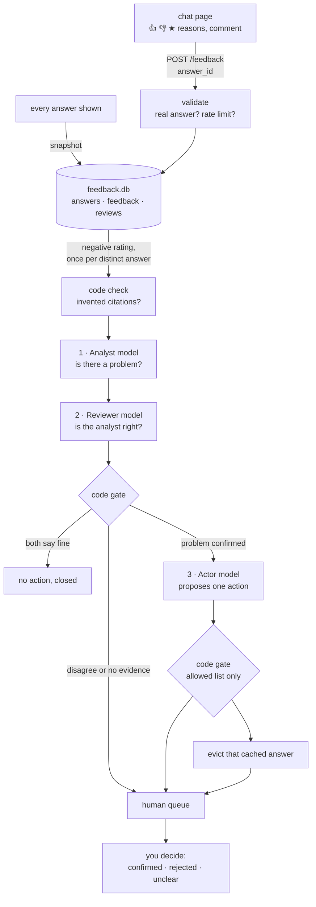

# User feedback and three-model review

Users rate answers. A rating never changes anything directly: it queues a review by three models, and plain code decides what is allowed to happen.

## Architecture



## Who sees what

| Input | Analyst | Reviewer | Actor | You |
| --- | --- | --- | --- | --- |
| Question, abstracts, answer | yes | yes | yes | yes |
| User's reason buttons (marked unverified) | yes | **no** | only if the analyst mentions it | yes |
| User's typed comment | **no** | **no** | **no** | yes |
| Analyst's finding | | yes | yes | yes |

## The gate (`allowed_actions` in `papertrail/agents.py`)

| Situation | Outcome | Allowed actions |
| --- | --- | --- |
| A cited id wasn't among the papers shown (code check) | confirmed | evict, test case, human |
| Analyst and reviewer both see a problem, and any quoted evidence really is in the answer | confirmed | evict, test case, human |
| Both see no problem | no problem | no action |
| They disagree, or the quoted evidence isn't in the answer | uncertain | human only |

An action outside the list is replaced by "flag for human". Anything other than "no action" stays in the human queue.

| Action | What happens |
| --- | --- |
| `evict_cached_answer` | That one Redis entry is deleted; the next asker gets a fresh answer. Then waits for you. |
| `add_test_case` | Marked in the queue as worth testing. You add it to the test questions. |
| `flag_for_human` | Waits for you. |
| `no_action` | Closed. |

No model can change ranking, prompts, code or papers.

## Protection against manipulation

| Attempt | What stops it |
| --- | --- |
| Many thumbs-down to push an answer out | Votes don't act; one review per distinct answer; models judge from the papers |
| Instructions typed into the comment | Comments never reach a model |
| Rating an answer that was never given | Ratings need a server-issued `answer_id`; the content comes from the server's snapshot |
| Flooding | One rating per visitor per answer, hourly limit per visitor and address, daily review limit |
| A model tricked or wrong | A second model must agree, evidence is checked by code, actions come from a fixed list |

Limits: visitor ids are cookies and easy to reset; a question itself can contain instructions that the models read (they are told to treat it as material, which reduces but does not remove the risk); two free models can be wrong in the same way.

## Using it

```bash
papertrail feedback list                      # queue, the ones needing you first
papertrail feedback show 1                    # answer, ratings (with comments), what each model said
papertrail feedback decide 1 confirmed --note "claim not in the abstract"
papertrail feedback run                       # run queued or failed reviews now
```

| Setting | Default |
| --- | --- |
| `FEEDBACK_REVIEW` | `on`: review right after a negative rating |
| `FEEDBACK_DAILY_REVIEWS` | 10 (each uses 2-3 LLM calls, shared with your free answering quota) |
| `FEEDBACK_PER_HOUR` | 30 |
| `ANALYST_MODEL` | `baidu/ernie-5.5-flash-preview:free` |
| `REVIEWER_MODEL` | `nvidia/nemotron-3-ultra-550b-a55b:free` (the same model that writes answers by default) |
| `ACTOR_MODEL` | `nvidia/nemotron-3.5-lightning:free` |
| `FEEDBACK_DB` | `~/rag-data/feedback.db` |

Questions, answers, ratings and comments are stored on your machine; the review sends the question, answer and abstracts to the model provider. Tell users this before putting it online.

## Tests so far

`tests/test_feedback.py` covers the gate, independence, injection, limits and the endpoint with faked models. With the real models, one run each: a correct answer rated "wrong" was left alone, and an answer with planted false claims was confirmed and evicted. Two examples show it works end to end, not how often it is right: compare its verdicts with yours as reviews accumulate.
