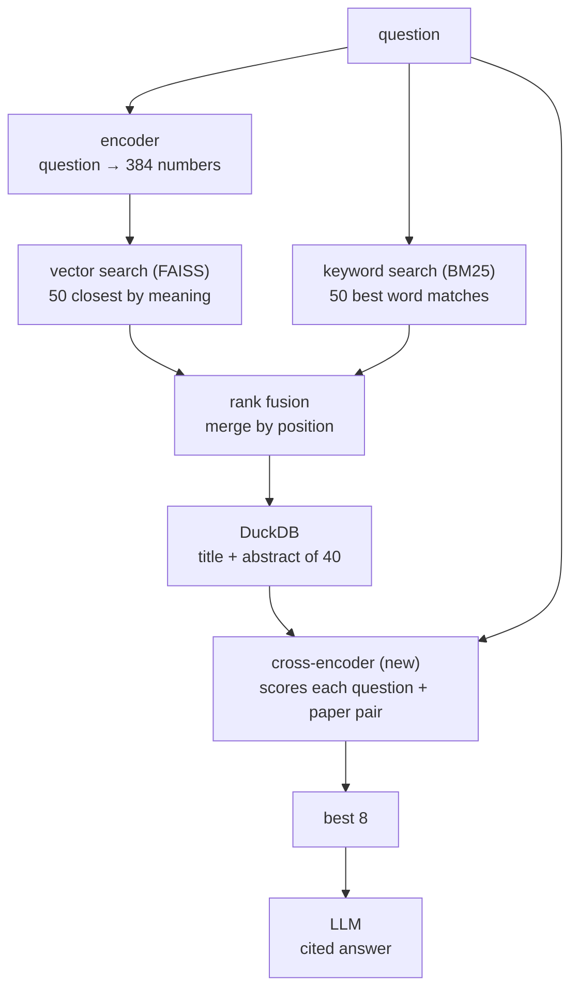

# Reranking with a cross-encoder

A second, more careful reader: after the fast searches shortlist 40 papers, a cross-encoder reads the question together with each paper and re-sorts them. The best 8 go to the LLM. **Off by default** (`RERANK=on` enables it); see [Results](#results) for why.

## System design



1,044,349 papers → 40 candidates (fast, rough) → 8 papers (slow, careful) → answer.

## How it was built, and why

| Step | What we did | Why |
| --- | --- | --- |
| 1. Choose models | Exported a small one (`ms-marco-MiniLM-L-6-v2`) and a larger one (`bge-reranker-base`) | It runs once per candidate on a CPU, so size decides speed; measure both before choosing |
| 2. Convert to ONNX int8 | `scripts/export_reranker.py`, once, in the export environment | Same reason as the question encoder: no PyTorch at question time, faster on this CPU |
| 3. Write the reranker | `papertrail/reranker.py`: pair question and paper, run, sort by score; batches grouped by text length | Padding a batch to its longest text wastes work; grouping similar lengths limits that |
| 4. Verify and time | `scripts/compare_rerankers.py` against the PyTorch originals | A converted model can silently give wrong scores |
| 5. Tune | Threads 4–16, batch sizes 1–40 | Fastest was batch 4; thread count mattered little from 6 to 12 |
| 6. Add to search | After the database lookup and category filter, before the LLM | The reranker needs the text, and there is no point scoring papers the filter removes |
| 7. Measure quality | `papertrail eval` and a blind check on real questions | To decide whether the extra time buys better papers |

## Speed and model choice

10 questions × 40 candidates, i7-13620H, 8 threads. "Same as PyTorch" compares the top 8 chosen.

| Model | Variant | Same top 8 as PyTorch | Seconds per question |
| --- | --- | --- | --- |
| MiniLM | PyTorch | reference | 2.33 |
| MiniLM | ONNX float32 | 100% | 2.26 |
| **MiniLM** | **ONNX int8** (used) | 91% | **1.37** |
| bge-base | PyTorch | reference | 16.68 |
| bge-base | ONNX float32 | 100% | 15.73 |
| bge-base | ONNX int8 | 81% | 6.88 |

MiniLM int8 was chosen: the larger model is far too slow for live questions here (its answer quality was not evaluated). int8 changes about one of the 8 picks compared with full precision; set `int8=False` in `Reranker` to trade 0.9 s for exact scores.

## Results

### Finding the source paper (`papertrail eval`, 200 questions each)

| Question made from | Right paper 1st: hybrid → + reranker | In top 10 | Search time |
| --- | --- | --- | --- |
| a sentence of the abstract | 45.0% → **96.0%** | 95.5% → 99.0% | 124 ms → 1.7 s |
| the paper's title | 93.5% → **99.0%** | 99.5% → 99.5% | 87 ms → 1.5 s |

These questions contain the paper's own words, which suits a model that reads both texts side by side. They show the reranker is excellent at picking out a specific paper.

### Real questions (blind check, `scripts/judge_rerank.py`)

12 questions; each paper graded 2 (answers it), 1 (related) or 0 (irrelevant) by an LLM that didn't know which method chose it.

| Top 8 | Directly relevant | Irrelevant | Mean grade (0–2) |
| --- | --- | --- | --- |
| hybrid | 69.8% | 10.4% | 1.59 |
| hybrid + reranker | 67.7% | **4.2%** | 1.64 |

Better on 6 questions, worse on 4, same on 2.

**Reading:** fewer irrelevant papers reach the LLM, but no more directly relevant ones, and the overall difference is within noise for 12 questions graded by a model. Not proven either way, which is why reranking is off by default while it adds about 1.5 s per question.

## Using it

```bash
RERANK=on papertrail search "How can we defend LLMs against prompt injection?"   # one run
```

Or set `RERANK=on` in `.env`. Results show where each paper stood before reranking (`was #38`). Settings: `RERANK_MODEL` (`minilm`, `bge`), `RERANK_CANDIDATES` (40), `RERANK_BATCH` (4).

## At scale
Reranking cost depends on the number of candidates, not the corpus size, so adding papers does not slow it. Under many simultaneous users it becomes the CPU bottleneck: serve it from a GPU or a hosted reranking service, or rerank fewer candidates.
